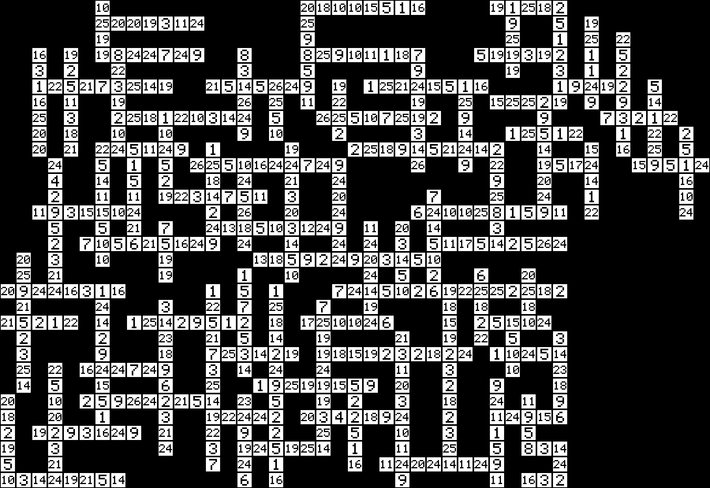

# Crossword 1

**Category:** Crypto · **Points:** 1000 · **Author:** ayushch

> Fill this FOOTBALL themed crossword but in kBxAc way!

**Flag:** `kBxAc{LFULLBACKSCOUT_OFFSIDEORAS_SROCOH_KSSWEEPERWWORLDCUPASSISTCA_ITHIARSICT_CHAMPIONSMANAGERSCOMEBACKCRESTA_KDSGODHSOBOOTSRRN_OITOUCHLINEAGOALPOSTRRPITCH_FULLRLTINCOACHCHT_FMHEADERCSTOURNAMENTNBKOA_EACAGOALKEEPERGRHSAVEBRACE_XNATUEMERFNK_TDDSHINPADIFPOECL_DRIBBLETGFEYELLOWCARDHE_AAMPEQUALIZERDFNI_TPLAYMAKERENEEIADVANTAGE_FILSQUARTERFINAL_OMSCLEATYF_FREEKICKCACPENALTYSHOOTOUT_MEIHPOPSUUU_MATCHNCONTRACTUVOLLEYBTABLE_TTJMANSMSHAI_IRUPOINTSSUBSTITUTECLEAN_OHKEEPERINEEDILJ_NABYOCROSSBARFTRU_FLTARGETMANJASTIUEDR_UFCISHEETFIXTURETDERBY_TSTRIKERMHRTOALICA_SIEISEASONCDOAWIN_AMPECKDEFENDERE_LINESMANYKRDKIT}`

---

## TL;DR

This is a **codeword puzzle** (a crossword where every letter is replaced by a number 1–26, and you have to work out the substitution yourself) dressed up as a football quiz. We OCR'd the grid, solved the substitution by matching each word to football-themed vocabulary, and then burned *hours* trying to turn the recovered cipher key into a flag before realising the challenge shipped a **second attachment** — `instructions.txt` — that we'd never downloaded, which spelled out in plain English exactly how to build the flag from the solved grid. Moral of the story: always enumerate every file CTFd actually gives you, not just the ones sitting in your local folder.

## What We're Given

The description is short and a little cheeky:

> Fill this FOOTBALL themed crossword but in kBxAc way!

The only thing we initially downloaded was `crossword1.zip`, which unzips to `crossword.png` — a 1800×1240 pure black-and-white image. No README, no second file visible in the local directory. That turned out to be a critical gap (more on that below).



Instead of letters in the white squares, every filled cell has a number printed in it, ranging from 1 to 26. No clues are given anywhere — just the grid itself. That's the whole puzzle.

## Initial Recon

`file` just confirms it's a plain 1800×1240 RGB PNG. A quick pixel scan shows the image is pure black (0) and white (255) — no greyscale, no highlighted cells, nothing stego-looking baked into the pixels.

The grid geometry is very regular: a 40px cell pitch, giving a **31-row × 45-column** grid, each white box 36px with a 4px black border. That regularity is the first clue that this is meant to be parsed programmatically — nobody's manually transcribing a 31×45 grid of two-digit numbers.

A codeword puzzle (aka "cipher crossword" / "code-cracker") is a well-known format: every cell holds a number 1–26, and each number stands for one letter throughout the whole grid — a simple substitution cipher applied to an entire crossword. You solve it like a normal crossword, just without clues: word patterns, letter frequency, cross-checking shared cells. Counting distinct numbers confirmed exactly **26 unique values**, 569 filled cells, and 99 across/down entries — consistent with a proper codeword.

## The Vulnerability / Core Concept

There's no "vulnerability" in the crypto sense here — it's a logic puzzle. The trick has two layers, and the second caused far more pain than the first.

**Layer 1 — solving the substitution.** With no clues, every three-or-more-letter run has to be a *real* (football) word:

1. **OCR by pixel-pattern clustering.** Because the image is a clean render, every cell showing "7" has byte-for-byte identical pixels to every other "7". Hashing each 36×36 cell crop gives exactly 26 distinct hashes — one per digit. We OCR *one* representative of each cluster instead of all 569 cells.
2. **Repeat-pattern signatures.** The word `LEVEL` has pattern `(0,1,2,1,0)`. Since the cipher is 1:1, an encoded entry's numbers must share the plaintext word's signature, which filters a word list down to viable candidates by shape alone.
3. **Constraint propagation.** Whenever an entry has exactly one consistent candidate, lock in those letter↔number pairs and repeat. This cascades until the whole alphabet falls out.
4. A general dictionary alone wasn't enough — plenty of entries were football jargon (`SHINPAD`, `YELLOWCARD`, `PENALTYSHOOTOUT`, `TARGETMAN`…), so we fed in a hand-built football vocabulary list.

Cross-checking against English letter frequency (our "E" cluster appeared 61 times, "Z" once) confirmed the OCR labels were genuinely correct, not just internally consistent. The recovered key:

```
1=C  2=T  3=I  4=X  5=A  6=Y  7=P  8=W  9=R  10=L  11=D  12=Z  13=Q
14=N 15=B 16=K 17=V 18=U 19=S 20=F 21=M 22=H 23=J 24=E 25=O 26=G
```

**Layer 2 — the actual trap.** That key *looks* like the answer: a 26-char random-looking string in a crypto challenge screams "submit me." **It isn't the flag.** We tried uppercase, lowercase, reversed, inverted mappings, keyword-cipher deconstructions, Caesar/Vigenère against "football"/"kBxAc", and reading the grid every which way (rows, columns, diagonals, spiral, acrostics…) — all rejected against CTFd's rate limiter.

The resolution: **there was a second attachment we never downloaded.** `crossword1.zip` only held the PNG, but the full CTFd challenge JSON (`GET /api/v1/challenges/<id>`) lists a `files` array including `instructions.txt`, which spells out the flag construction exactly:

```
Read the alphabetical characters of the solved grid row by row, left to right.
For each row: extract the letters, keep rows top-to-bottom, separate rows with "_",
and enclose the whole thing in kBxAc{...}.
```

So the "flag" was never a hidden token or transformed key — it's literally **the solved grid serialised row by row**, with underscores between rows.

## Building the Exploit

The full pipeline is in [`solve.py`](solve.py). Three stages:

**1. OCR the grid by pixel-pattern clustering.** Binarise, slice into 40px cells, and for every mostly-white cell hash the raw pixel bytes and look up a pre-built `HASHMAP` (hash → digit):

```python
box = ab[r*40+2:r*40+38, c*40+2:c*40+38]
if box.mean() > 0.3:                      # white box == filled cell
    grid[r][c] = HASHMAP[hashlib.md5(box.tobytes()).hexdigest()[:8]]
```

**2. Solve the substitution via signature matching + propagation:**

```python
def sig(seq):                             # repeat-pattern of a sequence
    mp = {}; o = []
    for x in seq:
        mp.setdefault(x, len(mp)); o.append(mp[x])
    return tuple(o)
# ... bucket the dictionary by (len, sig), then fixpoint-propagate single-candidate entries
```

**3. Build the flag per `instructions.txt`:**

```python
rows = [''.join(num2let[grid[r][c]] for c in range(ncols) if grid[r][c]) for r in range(nrows)]
flag = 'kBxAc{' + '_'.join(rows) + '}'
```

## Running It

```
$ python3 solve.py
key (number->letter 1..26): CTIXAYPWRLDZQNBKVUSFMHJEOG
kBxAc{LFULLBACKSCOUT_OFFSIDEORAS_SROCOH_KSSWEEPERWWORLDCUPASSISTCA_...}
```

Squint at the row dumps and the football words are all there — `SWEEPER`, `WORLDCUP`, `CHAMPIONS`, `GOALKEEPER`, `TOURNAMENT`, `SHINPAD`, `YELLOWCARD`, `QUARTERFINAL`, `PENALTYSHOOTOUT`, `CROSSBAR`, `TARGETMAN`, `STRIKER`, `DEFENDER`, `LINESMAN` — smashed together with letters from crossing vertical answers, exactly as the instructions asked.

## Key Takeaways

- **Enumerate every attachment the platform provides, via the API, not just your local folder.** `GET /api/v1/challenges/<id>` returns a `files` array — the local zip had the PNG, the API also listed `instructions.txt` with the entire flag rule. We reverse-engineered for hours something handed to us for free.
- **Codeword/cipher-crossword puzzles** are solvable with no clues via (1) repeat-pattern signature matching and (2) constraint propagation across intersecting entries. A themed vocabulary list is often essential alongside a general dictionary.
- **Cluster identical pixel regions instead of per-cell OCR** when a puzzle is cleanly rendered — it's faster and far less error-prone.
- **A recovered key that "looks like the answer" might not be the answer.** Check whether the challenge told you what to do with it before grinding transforms against a rate limiter.
