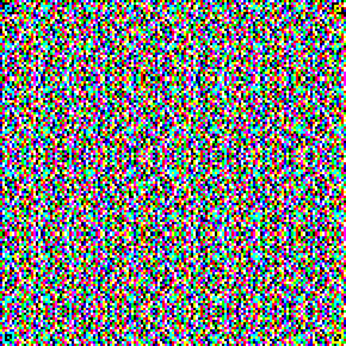

# 💉 (Syringe)

**Category:** Forensics · **Points:** 1000 · **Author:** adithG17

> The display showed something it shouldn't have. All we have is the traffic capture. Find out what was displayed.

**Flag:** `kBxAc{________________Wow_kya_LaDka_ha1_8heRY_h4ND$oM_Ky4_maal_h@I}`

> **Files:** `challenge.pcap` (the capture), `stream12.bin` (the reassembled TCP stream), and [`solve.py`](solve.py), which rebuilds the JAB Code shown below.

---

## TL;DR

The packet capture contains one unusually large TCP conversation going to port `9100`. Its payload is split into small `LR` records. After stripping those record headers and checksums, the remaining data is exactly `145 × 145` pixels stored as four-byte groups:

```text
07 RR GG BB
```

Rebuilding those pixels produces an eight-colour **JAB Code**. Decoding it reveals:

```text
kBxAc{________________Wow_kya_LaDka_ha1_8heRY_h4ND$oM_Ky4_maal_h@I}
```

---

## What we were given

The attachment was a ZIP archive containing a single packet capture:

```bash
# the capture is provided directly as challenge.pcap
```

That gives us:

```text
challenge.pcap
```

The prompt says that a **display showed something it should not have**, so the main goal is to find image-like or display-related data moving across the network.

## 1. Getting a quick overview of the capture

I started with a few basic Wireshark/TShark checks:

```bash
capinfos challenge.pcap
tshark -r challenge.pcap -q -z io,phs
tshark -r challenge.pcap -q -z conv,tcp
```

The capture contains 908 packets spread over roughly eight seconds. There is some normal-looking noise—HTTP, SSH, DNS, NTP, and so on—but one TCP conversation stands out:

```text
10.10.20.15:48172  ->  10.10.20.42:9100
```

It contains around 85 KB of actual TCP payload. Port `9100` is commonly associated with raw device or print data, and this was by far the largest unusual stream, making it a good place to look first.

Wireshark/TShark identifies it as `tcp.stream == 12`.

## 2. Extracting the suspicious TCP stream

TShark can print each packet's TCP payload as hexadecimal. Joining those pieces and converting the hex back into bytes gives us the full application stream:

```bash
tshark -r challenge.pcap \
  -Y 'tcp.stream==12 && ip.src==10.10.20.15 && tcp.payload' \
  -T fields -e tcp.payload |
tr -d '\n' |
xxd -r -p > stream12.bin
```

The resulting file is `84,847` bytes long.

Looking at its beginning shows a repeating pattern:

```bash
xxd -g 1 -l 64 stream12.bin
```

```text
4c 52 01 00 00 04 00 ...
```

The first two bytes are the ASCII letters `LR`. By comparing multiple repetitions, the record structure becomes clear:

| Offset | Size | Meaning |
|---:|---:|---|
| `0` | 2 bytes | Magic value `LR` |
| `2` | 1 byte | Version, always `01` |
| `3` | 1 byte | Flags, always `00` here |
| `4` | 1 byte | Sequence number |
| `5` | 2 bytes | Big-endian payload length |
| `7` | variable | Record payload |
| end | 2 bytes | Checksum/trailer |

There are 83 records in total. The first 82 carry 1,024 payload bytes each, while the final record carries 132 bytes:

```text
(82 x 1024) + 132 = 84,100 payload bytes
```

## 3. Realizing that the payload is pixel data

Once the `LR` wrappers are removed, the payload falls neatly into groups of four:

```text
07 RR GG BB
```

The first byte is always `07`, so it appears to be a control or channel mask. The next three bytes are ordinary red, green, and blue values. Each colour component is either `00` or `ff`.

That means every four bytes describe one pixel, and there are:

```text
84,100 / 4 = 21,025 pixels
```

The particularly helpful part is:

```text
sqrt(21,025) = 145
```

So the data makes a perfect **145 by 145 pixel square**. That is unlikely to be a coincidence.

## 4. Rebuilding the displayed image

This Python script parses the records, removes their wrappers, and turns the RGB bytes into an image:

```python
from pathlib import Path
from PIL import Image

stream = Path("stream12.bin").read_bytes()

offset = 0
payload = bytearray()

while offset < len(stream):
    # Every record begins with the letters "LR".
    assert stream[offset:offset + 2] == b"LR"

    # Bytes 5 and 6 contain the payload length in big-endian order.
    length = int.from_bytes(stream[offset + 5:offset + 7], "big")

    start = offset + 7
    payload.extend(stream[start:start + length])

    # Header + payload + two-byte trailer/checksum
    offset += 7 + length + 2

pixels = []

for i in range(0, len(payload), 4):
    control, red, green, blue = payload[i:i + 4]
    assert control == 0x07
    pixels.append((red, green, blue))

assert len(pixels) == 145 * 145

image = Image.new("RGB", (145, 145))
image.putdata(pixels)
image.save("display.png")

# Nearest-neighbour scaling keeps every coloured square sharp.
image.resize((580, 580), Image.Resampling.NEAREST).save(
    "display_4x.png"
)
```

The result looks like this:



At first glance, it resembles colourful television static. It is not random, though. The image uses all eight colours that can be made when red, green, and blue are independently switched fully on or off:

```text
black, blue, green, cyan, red, magenta, yellow, white
```

That colour pattern, the square layout, and the large corner markers identify it as a **JAB Code**: essentially a colour barcode related to the familiar QR-code idea.

The challenge gives us two nice hints in hindsight:

- The title is a syringe emoji: a **jab**.
- The attachment is named `jab01.zip`.

## 5. Decoding the JAB Code

I used the Go-based [`srlehn/jabcode`](https://github.com/srlehn/jabcode) decoder. This image needs its `current-c` compatibility support, so I installed it with the relevant build tags:

```bash
GOBIN="$HOME/.local/bin" go install \
  -tags="jabcode_legacy jabcode_bsi jabcode_high_color" \
  github.com/srlehn/jabcode/cmd/jabcode@latest
```

Then I decoded the enlarged image:

```bash
jabcode decode --only current-c display_4x.png
```

Output:

```text
kBxAc{________________Wow_kya_LaDka_ha1_8heRY_h4ND$oM_Ky4_maal_h@I}
```

The 16 underscores immediately after the opening brace are part of the flag.

## Flag

```text
kBxAc{________________Wow_kya_LaDka_ha1_8heRY_h4ND$oM_Ky4_maal_h@I}
```

## Takeaways

- Start network-forensics challenges by checking protocol and conversation summaries rather than reading packets one by one.
- A large, unusual stream is often more interesting than familiar background traffic.
- Repeating magic bytes and steadily increasing sequence numbers usually indicate a custom record format.
- Do the size arithmetic: `84,100 / 4 = 21,025 = 145²` was the key clue that the payload contained square image data.
- Something that looks like colourful noise may still be a machine-readable barcode.

